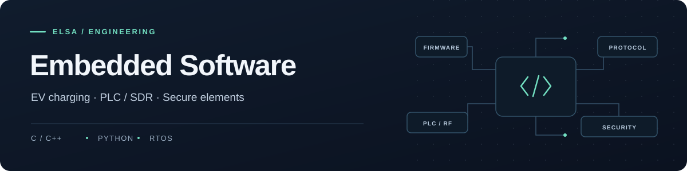

# Elsa · Embedded Software Engineer

**EV charging communication · PLC / SDR experiments · Secure-element integration**

**English** · [简体中文](README.zh-CN.md)

I develop embedded software for EV charging systems, from MCU drivers and RTOS applications to charging protocols and hardware security. My public work brings together protocol experiments, portable C middleware, signal-analysis tools, and practical build automation.

**Start here:** [PLC-PHY-Lab](https://github.com/Elsa-is-My-Muse/PLC-PHY-Lab) · [VDV 261 / V2ICP](https://github.com/Elsa-is-My-Muse/v2icp-lab) · [SE050E middleware](https://github.com/Elsa-is-My-Muse/se050e-crypto-middleware) · [Keil Builder](https://github.com/Elsa-is-My-Muse/keil_builder) · [Full project directory](#repository-directory)

## Featured projects

### [PLC-PHY-Lab](https://github.com/Elsa-is-My-Muse/PLC-PHY-Lab)

A **HomePlug Green PHY / CP–PE learning lab** connecting RF front ends, HackRF One, GNU Radio, and offline IQ analysis. Includes subband capture flows, synthetic examples, and structured experiment records. Standard HomePlug Green PHY decoding is a future goal.

[Source & overview](https://github.com/Elsa-is-My-Muse/PLC-PHY-Lab/blob/main/README.md) · [Learning plan](https://github.com/Elsa-is-My-Muse/PLC-PHY-Lab/blob/main/docs/LEARNING_PLAN.md) · [GNU Radio setup](https://github.com/Elsa-is-My-Muse/PLC-PHY-Lab/blob/main/sdr/README.md) · [Experiments](https://github.com/Elsa-is-My-Muse/PLC-PHY-Lab/blob/main/experiments/README.md)

### [V2ICP Lab · VDV 261](https://github.com/Elsa-is-My-Muse/v2icp-lab)

A local **VDV 261 / V2ICP learning and integration lab** with a simulated EVCC, an encrypted-byte relay, and a backend communicating over real **IPv6, TLS, and HTTP**. A browser dashboard supports live inputs, single-step exchanges, fault injection, and redacted report export. Intended for learning and integration experiments.

[Source & overview](https://github.com/Elsa-is-My-Muse/v2icp-lab/blob/master/README.en.md) · [Quick start](https://github.com/Elsa-is-My-Muse/v2icp-lab/blob/master/docs/quickstart.md) · [Hardware integration](https://github.com/Elsa-is-My-Muse/v2icp-lab/blob/master/docs/hardware-integration.md) · [Scope & limitations](https://github.com/Elsa-is-My-Muse/v2icp-lab/blob/master/docs/sources-and-limitations.md)

### [SE050E Crypto Middleware](https://github.com/Elsa-is-My-Muse/se050e-crypto-middleware)

Portable **C99 middleware for the NXP SE050E** secure element, with **PSA Crypto / Mbed TLS** integration and an **AT32F435 + RT-Thread** reference port. Covers session and key management, ECDSA signing, optional ECDH, explicit port interfaces, and host-based validation.

[Source & integration](https://github.com/Elsa-is-My-Muse/se050e-crypto-middleware/blob/main/README.en.md) · [CI builds](https://github.com/Elsa-is-My-Muse/se050e-crypto-middleware/actions/workflows/ci.yml)

### [Keil Builder](https://github.com/Elsa-is-My-Muse/keil_builder)

A **Python command-line tool for Keil MDK builds on Windows**. Automates project discovery and target selection, streams build output, and collects build logs and firmware artifacts.

[Source & usage](https://github.com/Elsa-is-My-Muse/keil_builder#readme)

## Technical focus

| Area | Technologies & project entry points |
| --- | --- |
| Embedded firmware | C / C++, ARM Cortex-M, STM32, AT32, RT-Thread, FreeRTOS · [SE050E reference port](https://github.com/Elsa-is-My-Muse/se050e-crypto-middleware) |
| Charging communication | ISO 15118, DIN 70121, OCPP, EVCC / SECC · [VDV 261 / V2ICP lab](https://github.com/Elsa-is-My-Muse/v2icp-lab) |
| PLC & signal analysis | HomePlug Green PHY, CP–PE, HackRF, GNU Radio, Python IQ analysis · [PLC-PHY-Lab](https://github.com/Elsa-is-My-Muse/PLC-PHY-Lab) |
| Cryptography | SE050E, PSA Crypto, Mbed TLS, keys and certificates · [Crypto middleware](https://github.com/Elsa-is-My-Muse/se050e-crypto-middleware) |
| Build & verification | Python, CMake, GCC / Clang, GitHub Actions, host-based tests · [Keil Builder](https://github.com/Elsa-is-My-Muse/keil_builder) |

## Repository directory

As of **2026-11-26**: **43 public repositories**, including **7 standalone repositories** (with this profile) and **36 forks**.

[All repositories](https://github.com/Elsa-is-My-Muse?tab=repositories) · [Standalone repositories](https://github.com/Elsa-is-My-Muse?tab=repositories&type=source) · [Forks](https://github.com/Elsa-is-My-Muse?tab=repositories&type=fork)

### My projects & experiments

| Repository | Purpose & status |
| --- | --- |
| [PLC-PHY-Lab](https://github.com/Elsa-is-My-Muse/PLC-PHY-Lab) | HomePlug Green PHY / CP–PE learning lab: GNU Radio flows, offline IQ analysis, and experiment notes. |
| [v2icp-lab](https://github.com/Elsa-is-My-Muse/v2icp-lab) | VDV 261 / V2ICP experiments with a local EVCC, encrypted-byte relay, backend, and browser dashboard. |
| [se050e-crypto-middleware](https://github.com/Elsa-is-My-Muse/se050e-crypto-middleware) | Portable NXP SE050E cryptographic middleware with PSA Crypto / Mbed TLS integration. |
| [keil_builder](https://github.com/Elsa-is-My-Muse/keil_builder) | Python automation for Keil MDK builds, logs, and firmware artifacts on Windows. |
| [pcap_packs](https://github.com/Elsa-is-My-Muse/pcap_packs) | Small packet-capture collection; currently contains one PCAPNG file. |
| [elsa-cpp-standard-library](https://github.com/Elsa-is-My-Muse/elsa-cpp-standard-library) | Early C++ repository; currently empty. |
| [Elsa-is-My-Muse](https://github.com/Elsa-is-My-Muse/Elsa-is-My-Muse) | This bilingual engineering portfolio and repository directory. |

### Upstream forks & references

Forks are grouped by subject below. Each repository identifies its upstream project and authors. Expand a category to browse every link.

<strong>EV charging & energy systems</strong> · 12 repositories

| Repository | Focus |
| --- | --- |
| [everest-core](https://github.com/Elsa-is-My-Muse/everest-core) | EVerest charge-controller modules. |
| [libocpp](https://github.com/Elsa-is-My-Muse/libocpp) | C++ implementation of OCPP. |
| [ocpp](https://github.com/Elsa-is-My-Muse/ocpp) | OCPP client implementation in C. |
| [libevse-security](https://github.com/Elsa-is-My-Muse/libevse-security) | EVSE certificate and security support. |
| [pyPLC](https://github.com/Elsa-is-My-Muse/pyPLC) | Python experiments with CCS charging. |
| [OpenV2Gx](https://github.com/Elsa-is-My-Muse/OpenV2Gx) | OpenV2G derivative with a command-line interface. |
| [wifi15118](https://github.com/Elsa-is-My-Muse/wifi15118) | EVCC / SECC communication over wireless networks. |
| [ccs32clara-chademo](https://github.com/Elsa-is-My-Muse/ccs32clara-chademo) | STM32 / QCA7005 firmware for a CCS2-to-CHAdeMO adapter. |
| [dc-charging-station](https://github.com/Elsa-is-My-Muse/dc-charging-station) | Software stack for a bidirectional DC charging station. |
| [gbt27930-2015](https://github.com/Elsa-is-My-Muse/gbt27930-2015) | GB/T 27930-2015 CAN message parsing. |
| [Battery-Emulator](https://github.com/Elsa-is-My-Muse/Battery-Emulator) | EV battery integration for stationary energy storage. |
| [Stm32-vcu](https://github.com/Elsa-is-My-Muse/Stm32-vcu) | STM32 vehicle control unit for EV conversion projects. |

<strong>PLC capture & protocol analysis</strong> · 6 repositories

| Repository | Focus |
| --- | --- |
| [WT32-ETH01 / QCA7000 bridge](https://github.com/Elsa-is-My-Muse/wt32eth01-ethernet-to-qca7000-bridge) | WT32-ETH01 Ethernet / SPI bridge experiment for QCA7000 / QCA7005. |
| [v2g-sniffing](https://github.com/Elsa-is-My-Muse/v2g-sniffing) | EV / EVSE traffic capture and SLAC network-parameter tools. |
| [AcCCS](https://github.com/Elsa-is-My-Muse/AcCCS) | Tools for EVCC / SECC communication and emulation. |
| [V2GEvil](https://github.com/Elsa-is-My-Muse/V2GEvil) | V2G communication evaluation tool. |
| [V2GInjector](https://github.com/Elsa-is-My-Muse/V2GInjector) | V2G PowerLine packet capture and injection tools. |
| [HomePlugPWN](https://github.com/Elsa-is-My-Muse/HomePlugPWN) | HomePlug AV protocol and security research tools. |

<strong>Embedded firmware & industrial communication</strong> · 8 repositories

| Repository | Focus |
| --- | --- |
| [CANopenNode](https://github.com/Elsa-is-My-Muse/CANopenNode) | CANopen protocol stack. |
| [SOEM](https://github.com/Elsa-is-My-Muse/SOEM) | Simple Open EtherCAT Master. |
| [tiny](https://github.com/Elsa-is-My-Muse/tiny) | Reusable components for event-driven embedded applications. |
| [tlsf](https://github.com/Elsa-is-My-Muse/tlsf) | Two-Level Segregated Fit memory allocator. |
| [tinyalloc](https://github.com/Elsa-is-My-Muse/tinyalloc) | Small allocator for unmanaged linear memory. |
| [JesFs](https://github.com/Elsa-is-My-Muse/JesFs) | Embedded filesystem for serial NOR flash. |
| [STM32 WS281x driver](https://github.com/Elsa-is-My-Muse/stm32-ws2811-ws2812-ws2812b-ws281x-tim-pwm-dma-timer) | STM32 LED driver using timers, PWM, and DMA. |
| [tddcode](https://github.com/Elsa-is-My-Muse/tddcode) | Examples accompanying Test-Driven Development for Embedded C. |

<strong>RF instruments & debugging</strong> · 3 repositories

| Repository | Focus |
| --- | --- |
| [hackrf](https://github.com/Elsa-is-My-Muse/hackrf) | HackRF software-defined radio platform. |
| [NanoVNA](https://github.com/Elsa-is-My-Muse/NanoVNA) | Compact vector network analyzer. |
| [Exlink_Tool](https://github.com/Elsa-is-My-Muse/Exlink_Tool) | Multifunction embedded debugging tool. |

<strong>Developer tools & reference projects</strong> · 7 repositories

| Repository | Focus |
| --- | --- |
| [mquickjs](https://github.com/Elsa-is-My-Muse/mquickjs) | Micro QuickJS JavaScript engine. |
| [formatting](https://github.com/Elsa-is-My-Muse/formatting) | Source-code formatting automation. |
| [nvimdots](https://github.com/Elsa-is-My-Muse/nvimdots) | Neovim configuration. |
| [the-art-of-command-line](https://github.com/Elsa-is-My-Muse/the-art-of-command-line) | Command-line reference and learning resource. |
| [linux-v0.01](https://github.com/Elsa-is-My-Muse/linux-v0.01) | Historical Linux 0.01 source. |
| [awesome-cpp](https://github.com/Elsa-is-My-Muse/awesome-cpp) | Curated C / C++ libraries and resources. |
| [hq-website](https://github.com/Elsa-is-My-Muse/hq-website) | Hack Quarantine website, built with Jekyll. |

## Engineering approach

I keep hardware-specific code behind explicit port interfaces, make builds and experiments reproducible, and document the evidence and limitations behind results.

## Get in touch

For technical questions, integration feedback, or collaboration, open an issue in the relevant project:

[PLC-PHY-Lab](https://github.com/Elsa-is-My-Muse/PLC-PHY-Lab/issues) · [V2ICP Lab](https://github.com/Elsa-is-My-Muse/v2icp-lab/issues) · [SE050E middleware](https://github.com/Elsa-is-My-Muse/se050e-crypto-middleware/issues) · [Keil Builder](https://github.com/Elsa-is-My-Muse/keil_builder/issues)
