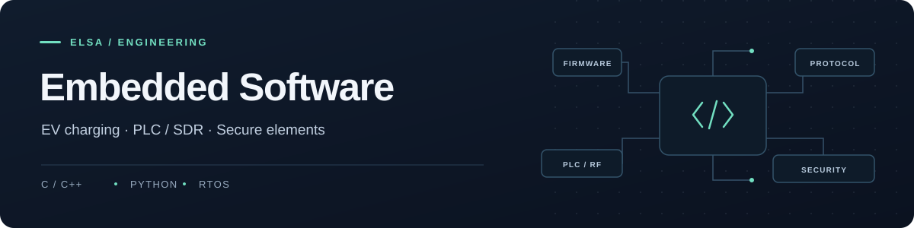

# Elsa · 嵌入式软件工程师

**EV 充电通信 · PLC / SDR 实验 · 安全芯片集成**

[English](README.md) · **简体中文**

我从事 EV 充电系统的嵌入式软件开发，工作涉及 MCU 驱动、RTOS 应用、充电协议与硬件安全。公开项目围绕协议实验、可移植 C 中间件、信号分析工具和构建自动化展开。

**快速入口：** [PLC-PHY-Lab](https://github.com/Elsa-is-My-Muse/PLC-PHY-Lab) · [VDV 261 / V2ICP](https://github.com/Elsa-is-My-Muse/v2icp-lab) · [SE050E 中间件](https://github.com/Elsa-is-My-Muse/se050e-crypto-middleware) · [Keil Builder](https://github.com/Elsa-is-My-Muse/keil_builder) · [完整项目目录](#完整仓库目录)

## 重点项目

### [PLC-PHY-Lab](https://github.com/Elsa-is-My-Muse/PLC-PHY-Lab)

面向 **HomePlug Green PHY / CP–PE 的学习实验室**，连接射频前端、HackRF One、GNU Radio 与离线 IQ 分析。提供分频段采集流程、合成信号示例与结构化实验记录；标准 HomePlug Green PHY 解码仍是后续目标。

[源码与说明](https://github.com/Elsa-is-My-Muse/PLC-PHY-Lab/blob/main/README.md) · [学习路线](https://github.com/Elsa-is-My-Muse/PLC-PHY-Lab/blob/main/docs/LEARNING_PLAN.md) · [GNU Radio 接入](https://github.com/Elsa-is-My-Muse/PLC-PHY-Lab/blob/main/sdr/README.md) · [实验目录](https://github.com/Elsa-is-My-Muse/PLC-PHY-Lab/blob/main/experiments/README.md)

### [V2ICP Lab · VDV 261](https://github.com/Elsa-is-My-Muse/v2icp-lab)

面向 **VDV 261 / V2ICP 学习与集成开发**的本地实验室：模拟 EVCC、加密字节中继和后台通过真实的 **IPv6、TLS 与 HTTP** 通信。浏览器仪表盘支持实时修改输入、单步收发、故障注入与脱敏报告导出，适合协议学习和集成实验。

[源码与说明](https://github.com/Elsa-is-My-Muse/v2icp-lab/blob/master/README.md) · [快速上手](https://github.com/Elsa-is-My-Muse/v2icp-lab/blob/master/docs/quickstart.md) · [硬件接入](https://github.com/Elsa-is-My-Muse/v2icp-lab/blob/master/docs/hardware-integration.md) · [来源与局限](https://github.com/Elsa-is-My-Muse/v2icp-lab/blob/master/docs/sources-and-limitations.md)

### [SE050E Crypto Middleware](https://github.com/Elsa-is-My-Muse/se050e-crypto-middleware)

面向 **NXP SE050E** 安全芯片的可移植 **C99 密码学中间件**，提供 **PSA Crypto / Mbed TLS** 集成与 **AT32F435 + RT-Thread** 参考移植。覆盖会话和密钥管理、ECDSA 签名、可选 ECDH、明确的移植接口以及主机端验证。

[源码与集成说明](https://github.com/Elsa-is-My-Muse/se050e-crypto-middleware/blob/main/README.md) · [CI 构建](https://github.com/Elsa-is-My-Muse/se050e-crypto-middleware/actions/workflows/ci.yml)

### [Keil Builder](https://github.com/Elsa-is-My-Muse/keil_builder)

用于 **Windows 平台 Keil MDK 构建自动化**的 Python 命令行工具，支持工程发现、目标选择、实时构建输出，以及构建日志与固件产物收集。

[源码与使用说明](https://github.com/Elsa-is-My-Muse/keil_builder#readme)

## 技术方向

| 方向 | 技术与项目入口 |
| --- | --- |
| 嵌入式固件 | C / C++、ARM Cortex-M、STM32、AT32、RT-Thread、FreeRTOS · [SE050E 参考移植](https://github.com/Elsa-is-My-Muse/se050e-crypto-middleware) |
| 充电通信 | ISO 15118、DIN 70121、OCPP、EVCC / SECC · [VDV 261 / V2ICP 实验室](https://github.com/Elsa-is-My-Muse/v2icp-lab) |
| PLC 与信号分析 | HomePlug Green PHY、CP–PE、HackRF、GNU Radio、Python IQ 分析 · [PLC-PHY-Lab](https://github.com/Elsa-is-My-Muse/PLC-PHY-Lab) |
| 密码学与安全芯片 | SE050E、PSA Crypto、Mbed TLS、密钥与证书 · [密码学中间件](https://github.com/Elsa-is-My-Muse/se050e-crypto-middleware) |
| 构建与验证 | Python、CMake、GCC / Clang、GitHub Actions、主机端测试 · [Keil Builder](https://github.com/Elsa-is-My-Muse/keil_builder) |

## 完整仓库目录

截至 **2026-11-26**，共有 **43 个公开仓库**：**7 个非 Fork 仓库**（含个人主页）和 **36 个 Fork 仓库**。

[查看全部仓库](https://github.com/Elsa-is-My-Muse?tab=repositories) · [查看非 Fork 仓库](https://github.com/Elsa-is-My-Muse?tab=repositories&type=source) · [查看 Fork 仓库](https://github.com/Elsa-is-My-Muse?tab=repositories&type=fork)

### 我的项目与实验

| 仓库 | 内容与状态 |
| --- | --- |
| [PLC-PHY-Lab](https://github.com/Elsa-is-My-Muse/PLC-PHY-Lab) | HomePlug Green PHY / CP–PE 学习实验室：GNU Radio 流程、离线 IQ 分析与实验记录。 |
| [v2icp-lab](https://github.com/Elsa-is-My-Muse/v2icp-lab) | VDV 261 / V2ICP 实验：本地 EVCC、加密字节中继、模拟后台与浏览器仪表盘。 |
| [se050e-crypto-middleware](https://github.com/Elsa-is-My-Muse/se050e-crypto-middleware) | 可移植的 NXP SE050E 密码学中间件与 PSA Crypto / Mbed TLS 集成。 |
| [keil_builder](https://github.com/Elsa-is-My-Muse/keil_builder) | 用于 Windows 平台 Keil MDK 构建、日志与固件产物收集的 Python 工具。 |
| [pcap_packs](https://github.com/Elsa-is-My-Muse/pcap_packs) | 小型抓包文件仓库，目前包含一个 PCAPNG 文件。 |
| [elsa-cpp-standard-library](https://github.com/Elsa-is-My-Muse/elsa-cpp-standard-library) | 早期 C++ 仓库，目前为空。 |
| [Elsa-is-My-Muse](https://github.com/Elsa-is-My-Muse/Elsa-is-My-Muse) | 当前的中英文工程作品主页与仓库目录。 |

### Fork 与参考项目

以下为上游项目的 Fork，按主题整理；原始作者与来源见各仓库的 Fork 信息。展开分类即可查看全部入口。

<strong>EV 充电与能源系统</strong> · 12 个仓库

| 仓库 | 方向 |
| --- | --- |
| [everest-core](https://github.com/Elsa-is-My-Muse/everest-core) | EVerest 充电控制模块。 |
| [libocpp](https://github.com/Elsa-is-My-Muse/libocpp) | OCPP 的 C++ 实现。 |
| [ocpp](https://github.com/Elsa-is-My-Muse/ocpp) | C 语言 OCPP 客户端实现。 |
| [libevse-security](https://github.com/Elsa-is-My-Muse/libevse-security) | EVSE 证书与安全支持。 |
| [pyPLC](https://github.com/Elsa-is-My-Muse/pyPLC) | 基于 Python 的 CCS 充电通信实验。 |
| [OpenV2Gx](https://github.com/Elsa-is-My-Muse/OpenV2Gx) | 带命令行接口的 OpenV2G 衍生项目。 |
| [wifi15118](https://github.com/Elsa-is-My-Muse/wifi15118) | 无线网络上的 EVCC / SECC 通信。 |
| [ccs32clara-chademo](https://github.com/Elsa-is-My-Muse/ccs32clara-chademo) | 面向 CCS2 转 CHAdeMO 适配器的 STM32 / QCA7005 固件。 |
| [dc-charging-station](https://github.com/Elsa-is-My-Muse/dc-charging-station) | 双向直流充电站的软件栈。 |
| [gbt27930-2015](https://github.com/Elsa-is-My-Muse/gbt27930-2015) | GB/T 27930-2015 CAN 报文解析。 |
| [Battery-Emulator](https://github.com/Elsa-is-My-Muse/Battery-Emulator) | 用于固定式储能的电动车电池集成项目。 |
| [Stm32-vcu](https://github.com/Elsa-is-My-Muse/Stm32-vcu) | 用于电动车改装项目的 STM32 整车控制器。 |

<strong>PLC 抓包与协议分析</strong> · 6 个仓库

| 仓库 | 方向 |
| --- | --- |
| [WT32-ETH01 / QCA7000 bridge](https://github.com/Elsa-is-My-Muse/wt32eth01-ethernet-to-qca7000-bridge) | 面向 QCA7000 / QCA7005 的 WT32-ETH01 以太网 / SPI 桥接实验。 |
| [v2g-sniffing](https://github.com/Elsa-is-My-Muse/v2g-sniffing) | EV / EVSE 流量捕获与 SLAC 网络参数工具。 |
| [AcCCS](https://github.com/Elsa-is-My-Muse/AcCCS) | EVCC / SECC 通信与模拟工具集。 |
| [V2GEvil](https://github.com/Elsa-is-My-Muse/V2GEvil) | V2G 通信评估工具。 |
| [V2GInjector](https://github.com/Elsa-is-My-Muse/V2GInjector) | V2G 电力线网络报文捕获与注入工具。 |
| [HomePlugPWN](https://github.com/Elsa-is-My-Muse/HomePlugPWN) | HomePlug AV 协议与安全研究工具。 |

<strong>嵌入式固件与工业通信</strong> · 8 个仓库

| 仓库 | 方向 |
| --- | --- |
| [CANopenNode](https://github.com/Elsa-is-My-Muse/CANopenNode) | CANopen 协议栈。 |
| [SOEM](https://github.com/Elsa-is-My-Muse/SOEM) | 开源 EtherCAT 主站。 |
| [tiny](https://github.com/Elsa-is-My-Muse/tiny) | 面向事件驱动嵌入式应用的可复用组件。 |
| [tlsf](https://github.com/Elsa-is-My-Muse/tlsf) | TLSF 内存分配器。 |
| [tinyalloc](https://github.com/Elsa-is-My-Muse/tinyalloc) | 面向线性内存场景的小型分配器。 |
| [JesFs](https://github.com/Elsa-is-My-Muse/JesFs) | 面向串行 NOR Flash 的嵌入式文件系统。 |
| [STM32 WS281x driver](https://github.com/Elsa-is-My-Muse/stm32-ws2811-ws2812-ws2812b-ws281x-tim-pwm-dma-timer) | 使用定时器、PWM 与 DMA 的 STM32 LED 驱动。 |
| [tddcode](https://github.com/Elsa-is-My-Muse/tddcode) | 《测试驱动的嵌入式 C 语言开发》配套示例代码。 |

<strong>射频仪器与调试</strong> · 3 个仓库

| 仓库 | 方向 |
| --- | --- |
| [hackrf](https://github.com/Elsa-is-My-Muse/hackrf) | HackRF 软件无线电平台。 |
| [NanoVNA](https://github.com/Elsa-is-My-Muse/NanoVNA) | 小型矢量网络分析仪。 |
| [Exlink_Tool](https://github.com/Elsa-is-My-Muse/Exlink_Tool) | 嵌入式多功能调试工具。 |

<strong>开发工具与参考项目</strong> · 7 个仓库

| 仓库 | 方向 |
| --- | --- |
| [mquickjs](https://github.com/Elsa-is-My-Muse/mquickjs) | Micro QuickJS JavaScript 引擎。 |
| [formatting](https://github.com/Elsa-is-My-Muse/formatting) | 源码格式自动化工具。 |
| [nvimdots](https://github.com/Elsa-is-My-Muse/nvimdots) | Neovim 配置。 |
| [the-art-of-command-line](https://github.com/Elsa-is-My-Muse/the-art-of-command-line) | 命令行参考与学习资料。 |
| [linux-v0.01](https://github.com/Elsa-is-My-Muse/linux-v0.01) | 早期 Linux 0.01 源码。 |
| [awesome-cpp](https://github.com/Elsa-is-My-Muse/awesome-cpp) | C / C++ 库与资源索引。 |
| [hq-website](https://github.com/Elsa-is-My-Muse/hq-website) | 使用 Jekyll 构建的 Hack Quarantine 网站。 |

## 工程实践

通过明确的移植接口隔离硬件相关代码，让构建与实验能够复现，并记录结果所依据的证据与局限。

## 交流与反馈

欢迎围绕技术问题、集成反馈或合作想法，在对应项目中发起 Issue：

[PLC-PHY-Lab](https://github.com/Elsa-is-My-Muse/PLC-PHY-Lab/issues) · [V2ICP Lab](https://github.com/Elsa-is-My-Muse/v2icp-lab/issues) · [SE050E 中间件](https://github.com/Elsa-is-My-Muse/se050e-crypto-middleware/issues) · [Keil Builder](https://github.com/Elsa-is-My-Muse/keil_builder/issues)
